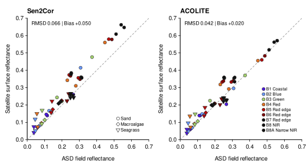
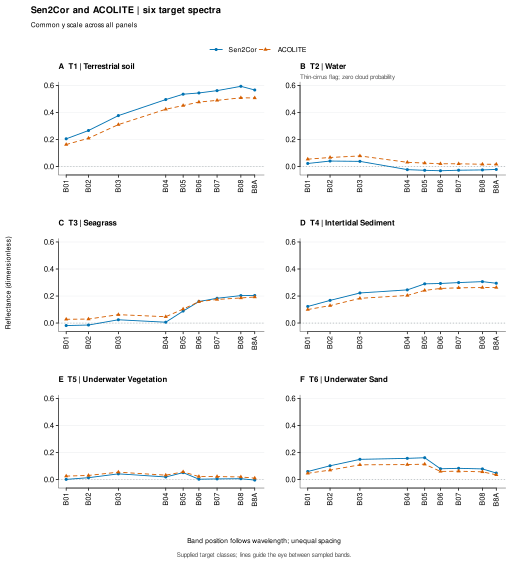

## Take-home message

**The two atmospheric corrections differ by target and band; a single offset cannot describe their relationship.** Across six targets and nine bands, signed Sen2Cor minus ACOLITE differences range from −0.054332 to +0.085140 in dimensionless reflectance. All 54 paired comparisons are available. These differences reveal sensitivity of the delivered reflectance to the correction product, but do not establish accuracy or superiority.

## Meaningful results

### Earlier station comparison

<figure id="fig-retained">

<figcaption><strong>Figure 1.</strong> Earlier station comparison of satellite and field-reference reflectance, retained unchanged as separate context. Each correction contains 54 values across nine bands; the dashed line marks equality and the axes have equal aspect. Internal legends identify bands and the Macroalgae, Sand and Seagrass display classes. Printed root-mean-square difference and bias are 0.066/+0.050 for Sen2Cor and 0.042/+0.020 for ACOLITE, respectively, in dimensionless reflectance. These descriptive summaries do not establish correction accuracy. This station comparison is distinct from the six target spectra below; neither its values nor its summaries are transferred to those targets.</figcaption>
</figure>

### Target-dependent magnitude and spectral shape

Sen2Cor exceeds ACOLITE in every sampled band at T1, T4 and T6, and is lower in every band at T2 and T5. At T3, Sen2Cor is lower through B05 and higher from B06 onward. The largest positive difference occurs at T1/B08 (+0.085140); the most negative occurs at T2/B04 (−0.054332). The target labels describe supplied classes, without independently establishing habitat identity.

<figure id="fig-target-spectra">

<figcaption><strong>Figure 3.</strong> A–F: T1 terrestrial soil, T2 water, T3 seagrass, T4 intertidal sediment, T5 underwater vegetation and T6 underwater sand. Sen2Cor (blue circles, solid lines) and ACOLITE (orange triangles, dashed lines) show dimensionless reflectance at the same nine band positions. Positions follow wavelength with unequal spacing; lines guide the eye between sampled bands. Every panel shares the same y-axis range for direct comparison of absolute magnitudes. All six targets and all 108 values are shown, including nine negative Sen2Cor values. No band or paired comparison is missing. T2 carries a thin-cirrus classification despite zero cloud probability. Class names are supplied labels, and the spectra do not demonstrate correction accuracy.</figcaption>
</figure>

Both corrections rise from B01 through B08 at T1 and then decline at B8A. At T3, both rise from B04 through B8A even though their ordering reverses. Both have their highest sampled reflectance at B05 for T5 and T6. Other features differ: at T2, the highest sampled reflectance is at B02 for Sen2Cor and B03 for ACOLITE; at T4, it is at B08 and B8A, respectively. These are features of the sampled bands, without implying a continuous-spectrum maximum or an ecological mechanism.

| Target | Supplied class | Mean signed difference | Mean absolute difference | Minimum difference | Maximum difference |
|---|---|---:|---:|---:|---:|
| T1 | Terrestrial soil | 0.067266 | 0.067266 | 0.042381 | 0.085140 |
| T2 | Water | -0.042896 | 0.042896 | -0.054332 | -0.026372 |
| T3 | Seagrass | -0.016096 | 0.024724 | -0.046423 | 0.017395 |
| T4 | Intertidal Sediment | 0.037992 | 0.037992 | 0.022808 | 0.048643 |
| T5 | Underwater Vegetation | -0.015158 | 0.015158 | -0.024315 | -0.005627 |
| T6 | Underwater Sand | 0.028302 | 0.028302 | 0.012922 | 0.047605 |

Signed differences are Sen2Cor minus ACOLITE. Each mean weights the same nine finite band pairs equally, rather than by spectral width. Mean absolute difference measures discrepancy between products, not error against truth; observed minimum and maximum differences are not uncertainty bounds. Values are rounded to six decimal places. Across all targets, 31 differences are positive and 23 negative. Their pooled mean is +0.009902, whereas their mean absolute difference is 0.036056: opposing signs cancel in the pooled mean, obscuring target-specific differences.

## Issues and limitations

**Quality indicators and negative values.** Nine negative Sen2Cor values occur across six bands at T2, two at T3 and one at T5. They remain visible. At T2, the thin-cirrus classification conflicts with zero cloud probability, so zero probability cannot establish clear conditions. An independent ACOLITE quality mask is unavailable. Availability of a reflectance value does not demonstrate that it is physically reliable.

**Spatial support and interpretation.** The products represent different stored areas for the coarser bands, and equivalent effective optical support is unverified. Consequently, the observed discrepancies cannot be attributed solely to atmospheric correction. No two requested targets share a stored cell within a correction and band, but this does not establish ecological independence. Correlated bands and selected targets do not provide independent replicates for population inference or class-wide conclusions. No independent accuracy reference supports ranking the corrections, and no significance test or uncertainty interval is inferred from these descriptive comparisons.

**Scope of comparison.** The target spectra compare the two satellite products at the same locations. They do not validate either product against field spectra. Earlier field-reference limitations remain specific to the separate station comparison and are not used to explain the target spectra. The common scale supports comparison of absolute reflectance and discrepancy among targets; small within-target features may be less prominent.

## Implications and next steps

The change in sign among targets, and within the T3 spectrum, shows why a uniform correction offset would be inadequate for these observations. Shared broad spectral features coexist with differences in magnitude and sampled peak position. The evidence supports examining target and band dependence before combining reflectance across products. Determining which values are closer to physical surface reflectance requires an independent reference and resolution of quality and spatial-support limitations. These descriptive results do not resolve earlier physical-validation holds.
