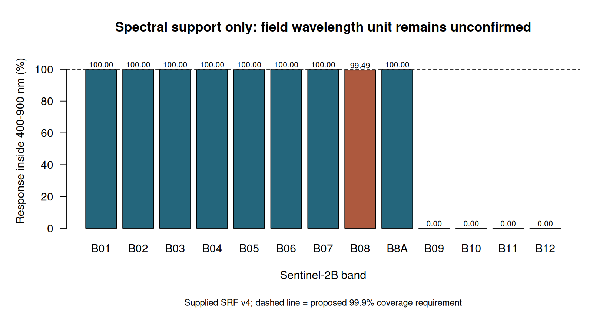

# March 27 ASD–Sentinel-2 data readiness

**CTR-28 feasibility handoff for CTR-27. Readiness: blocked for scientific extraction and validation.** Date joins and satellite metadata are established, and an explicit proposed contract is delivered. Zero pairs are currently included for extraction or inferential use. This completes the bounded feasibility audit; the parent scientific comparison, independent review and PI decisions remain pending. No algorithm ranking or final publication figure is produced.

## Question and scope

Can the supplied 27 March 2026 field spectra be compared fairly with the supplied operational Sentinel-2 Level-2A and ACOLITE surface reflectance? The audit separates evidence of date/identity from comparability of optical quantities and sampling support. It follows parent plan revision `e5d11291-44df-45ee-a80a-2e05b986c152` and reuses the CTR-25 dictionary revision `94e3777e-b618-4bf4-a88c-a7b502ca87d2`, commit `8d885c1c9ea1b10751dea939c2d1aee1432307bd`. The earlier dictionary was documentation, not scientific approval.

All edits are confined to `analysis/CTR-27_sen2cor-acolite-asd/`, initialized from `analysis/_template/`. `task.yml` records CTR-28 as implementation task. The clean starting checkout was fetched and passed `pi_guard.py preflight`; `verify-ready --task-id CTR-28 --agent roger-tomlinson --path analysis/CTR-27_sen2cor-acolite-asd/` returned ready, affected=false. The analysis exemption applies; no Ada synchronization mutation was required. Final manuscript and PI workspace were not edited.

## Field evidence and exact proposed crosswalk

The measurement log explicitly assigns **day06 to 20260327**, including AC01–08 for Sentinel-2 atmospheric-correction validation and day06 cover/core sampling. GPS `Sheet1` rows **110–124**, date serial **46108**, independently agree on 27 March 2026 using the workbook's default 1900 date system. No measurement time is supplied; zero Excel fractional day is not interpreted as midnight observation.

There are **15 date-eligible spectral columns**: AC_01–AC_08 and D06_A–D06_G. The eight AC stations are primary design candidates; seven D06 spectra are supplementary candidates whose pixel-sized sampling is undocumented. `station_crosswalk.csv` encodes the explicit alias list, preserving all three raw identifiers. This is a proposed evidence-based join, not a generic string normalization rule. Every March 27 proposed ID has exactly one spectrum, cover row and GPS row; no duplicate or unmatched identifier occurs within these 15. `spectrum_disposition.csv` accounts for every supplied spectral column and excludes other days from this investigation.

| ASD column | Station | GPS row | Label (verbatim) | Latitude (raw) | Longitude (raw) | Role |
| --- | --- | --- | --- | --- | --- | --- |
| AC_01 | AC01 | 110 | dry_sand | 19.883937 | -16.294369 | primary_candidate |
| AC_02 | AC02 | 111 | dry_sand | 19.883816 | -16.294463 | primary_candidate |
| AC_03 | AC03 | 112 | mbp_mud | 19.895208 | -16.499679 | primary_candidate |
| AC_04 | AC04 | 113 | mpb_mud | 19.896477 | -16.500781 | primary_candidate |
| AC_05 | AC05 | 114 | algae_mud | 19.898096 | -16.504162 | primary_candidate |
| AC_06 | AC06 | 115 | white_sand | 19.898859 | -16.504517 | primary_candidate |
| AC_07 | AC07 | 116 | seagrass | 19.899799 | -16.508523 | primary_candidate |
| AC_08 | AC08 | 117 | seagrass | 19.897776 | -16.502755 | primary_candidate |
| D06_A | D06_A | 118 | zn | 19.898679 | -16.506917 | supplementary_candidate |
| D06_B | D06_B | 119 | zn | 19.898684 | -16.506903 | supplementary_candidate |
| D06_C | D06_C | 120 | zn | 19.898814 | -16.507075 | supplementary_candidate |
| D06_D | D06_D | 121 | zn | 19.899237 | -16.507142 | supplementary_candidate |
| D06_E | D06_E | 122 | zn | 19.899335 | -16.507878 | supplementary_candidate |
| D06_F | D06_F | 123 | zn | 19.899720 | -16.508063 | supplementary_candidate |
| D06_G | D06_G | 124 | sand | 19.899536 | -16.508149 | supplementary_candidate |


These coordinates remain literal supplied lat/lon values with **unknown field datum, accuracy and measurement footprint**. No EPSG code is assigned to them. Both AC01 and AC02 have waypoint text `Iwik station` and coastal coordinates, while their workbook location says Arel; the record is preserved, not relocated to Arel. AC01/02 are approximately 21 km from the Arel AC group under the diagnostic WGS84 assumption. The cover table has no GPS waypoint for them; the workbook supplies coordinates. All other March 27 cover/GPS waypoints agree. D06_A–F carry cover and core identifiers; D06_G has label `sand`, cover 0. Cover units, the code `zn` and Poskey interpretation are not invented.

`AC03=mbp_mud` and `AC04=mpb_mud` are retained separately. Whether the former is a spelling error requires field confirmation. `seagrass` and `zn` do not establish species. No classifier or spectral resemblance was used to identify ecological classes.

The supplied `POI_S2C_ACOLITE_targets` has **six** EPSG:32628 points, named T1–T6: Terrestrial soil, Water, Seagrass, Intertidal Sediment, Underwater Vegetation, Underwater Sand. It has no AC/day06 identifiers or acquisition dates. It cannot provide a field crosswalk or evidence of March 27 exposure. Under the hypothetical field WGS84 transform, nearest point distances are about 1.30 km for AC01/02 and 5.57–5.77 km for the Arel group. These are unmatched records, not aliases. The two time-series polygons have AOI Arel/Iwik and null id fields; they are broad AOIs, not the AC field footprints. Extent and square-mask polygons supply spatial context only. Relevant features and CRS are preserved in `outputs/vector_records.json`.

### ASD quantity and sampling limitations

`202603_Reflectance_avg.txt` has **501 ordered wavelength rows**, numeric `wl` 400–900 at increment 1. All 15 candidate spectra are finite throughout; their pooled raw range is **0.0293690581–0.5736308287**. This range is a diagnostic and cannot establish fraction rather than percent. The header supplies neither wavelength nor reflectance units. No scaling was applied.

The log records number-to-save 20 and spectrum counts white=50, dark=20, sample=50. For AC01–08 it states **5 × 20 spectra within an area the size of an S2 pixel**. It does not specify which pixel resolution, field boundary, whether each exported average combines all 100 spectra with equal weights, replicate variance, smoothing, detector splice correction, invalid intervals, reference panel calibration, instrument model, field of view, height, view/illumination angles, timing or surface/water geometry. The combined average export cannot recover these quantities. Raw replicate spectra and field images mentioned in the log/table are not supplied in ASD/GPS. A read of the actual tables and log did not resolve these gaps.

`dry_sand` suggests dry conditions for AC01/02 but is not a timed exposure record. The log's water/glint/height details concern day05 and day07; they must not be transferred to day06. For AC03–08 and D06_A–G, exposed/emergent versus submerged status at field and satellite observation is unresolved. An underwater leaf/bed reflectance is not comparable to above-water pixel reflectance without a water-column/geometry model.

## Satellite identity, processing and spatial coverage

The expanded supplied product is **S2B_MSIL2A_20260327T113319_N0512_R080_T28QCH_20260327T152639.SAFE**. Product and datastrip XML identify Sentinel-2B, Level-2A, baseline **05.12**, relative orbit **80 descending**, absolute orbit **047296**, processing centre **2BPS**, generation **2026-03-27T15:26:39Z**. Product/datatake start is **11:33:19.024Z**. Tile XML, not the name alone, gives tile sensing **11:45:53.975343Z** and tile ID `S2B_OPER_MSI_L2A_TL_2BPS_20260327T152639_A047296_T28QCH_N05.12`.

This is an **operational Level-2A product using Sen2Cor-based processing**, not evidence of an independently rerun standalone Sen2Cor experiment. A standalone software version/configuration was not recovered; baseline and GIPP identifiers are available. No correction was rerun. The report should label this comparison operational L2A versus supplied ACOLITE DSF. Operational and user-generated L2A are distinct routes in the [official product documentation](https://sentiwiki.copernicus.eu/web/s2-products).

The 11 March 27 TIFFs in `S2/ACOLITE/20260327/` preserve embedded `NC_GLOBAL` metadata and band attributes even with PAM disabled. They explicitly identify **ACOLITE**, sensor `S2B_MSI`, L2W `rhos_*`, and **2026-03-27T11:45:53.975343+00:00**, exactly matching the L2A tile timestamp. Their source is recorded as `S2B_MSIL1C_20260327T113319_N0512_R080_T28QCH_20260327T150331.SAFE` under a historical Windows path; granule `L1C_T28QCH_A047296_20260327T113507`. Thus the same acquisition/platform/tile/orbit is supported by embedded headers. This does not prove byte-identical input ancestry: that March 27 Level-1C payload is not supplied for a hash check. The old Windows path is provenance, not an accessible input.

Recovered ACOLITE version is **Generic GitHub Clone c2026-04-07T11:45:24**, runid **20260407_115117**, generated **2026-04-07 13:26:22 Paris, Madrid (heure d’été)**. This string is not an exact Git commit. Settings embedded in every TIFF include `atmospheric_correction_method=dark_spectrum`, tiled AOT with intercept spectrum and min_drmsd selection, 600×600 tiles, linear tile interpolation and smoothing, selected `ac_model=ACOLITE-LUT-202110-MOD1`, target resolution 10 m, `warp_resampling_method=bilinear`, `l2w_parameters=rhos_*`, **l2w_mask=False**, no residual glint, interface-reflectance or adjacency correction. Model/header AOT values are processor provenance, not independent atmospheric measurements. An unused `dsf_fixed_lut=MOD2` setting must not replace the selected `ac_model=MOD1` in interpretation.

The TIFFs therefore recover much of the missing standalone 2026 settings/NetCDF provenance. Still missing are exact ACOLITE source SHA, LUT/ancillary content hashes, authenticated SRF version, complete execution log and recoverable March 27 source L1C. Current [ACOLITE source](https://github.com/acolite/acolite) and [GeoTIFF export code](https://raw.githubusercontent.com/acolite/acolite/main/acolite/output/nc_to_geotiff.py) explain the metadata/quantity conventions; current code does not authenticate the April clone. No settings from 2025 were substituted.

Both raster families declare **EPSG:32628**. L2A 10 m grid: origin **(300000,2300040)**, 10980×10980, bounds **x=300000–409800, y=2190240–2300040 m**. ACOLITE 10 m grid: origin **(334050,2209980)**, 3763×1974, bounds **x=334050–371680, y=2190240–2209980 m**. The AC crop is inside the SAFE grid, offset exactly **3405 columns and 9006 rows** at 10 m. This verifies grid alignment, not empirical geolocation or image registration accuracy.

L2A has B01–B09, B8A, B11 and B12 (12 unique bands); B10 is absent. Four 10 m bands are supplied, the 20 m set includes B01, and 60 m also includes B09. Native B01 support remains 60 m even where resampled to 20 m. ACOLITE has 11 `rhos` bands, including B01/B8A/B11/B12 but neither B09 nor B10. No March27 `l2_flags` file is supplied. Exact paths and per-band metadata are in `band_contract.csv` and captured headers.

| Band | ACOLITE variable | Native support (m) | Coverage if nm (%) | Proposed role |
| --- | --- | --- | --- | --- |
| B11 | rhos_1610 | 20 | 0.0000 | held: B08 incomplete or coarser support / no spectral coverage |
| B12 | rhos_2186 | 20 | 0.0000 | held: B08 incomplete or coarser support / no spectral coverage |
| B01 | rhos_442 | 60 | 100.0000 | held: B08 incomplete or coarser support / no spectral coverage |
| B02 | rhos_492 | 10 | 100.0000 | primary_candidate_10m |
| B03 | rhos_559 | 10 | 100.0000 | primary_candidate_10m |
| B04 | rhos_665 | 10 | 100.0000 | primary_candidate_10m |
| B05 | rhos_704 | 20 | 100.0000 | held: B08 incomplete or coarser support / no spectral coverage |
| B06 | rhos_739 | 20 | 100.0000 | held: B08 incomplete or coarser support / no spectral coverage |
| B07 | rhos_780 | 20 | 100.0000 | held: B08 incomplete or coarser support / no spectral coverage |
| B08 | rhos_833 | 10 | 99.4858 | held: B08 incomplete or coarser support / no spectral coverage |
| B8A | rhos_864 | 20 | 100.0000 | held: B08 incomplete or coarser support / no spectral coverage |


### Decode and quality contract

For L2A, product XML declares **BOA_QUANTIFICATION_VALUE=10000**, all 13 band-index offsets **−1000**, NODATA=0 and SATURATED=65535. Mask special codes first, then decode **(DN−1000)/10000**; JP2 band defaults alone are insufficient. This follows [official encoding guidance](https://sentiwiki.copernicus.eu/web/s2-products). ACOLITE TIFF bands are Float32 with unit **1**, `surface_bidirectional_reflectance`, NaN NoData and no additional scale/offset declared: read finite float values directly. Never divide them by 10000 or multiply by π. Do not compare Rrs (sr−1) directly to dimensionless reflectance; a π conversion alone cannot establish matching geometry or optical definitions.

Proposed common quality screening rejects SCL codes **0,1,2,3,7,8,9,10,11** and uses 4/5/6 only with independent field exposure evidence. Apply the same common mask to both methods; do not use an aquatic bright-land mask to discard the dry sand targets. Decode native defect/detector masks at extraction stage and require all pixels in an agreed primary support to pass. Do not silently average over a reduced footprint. ACOLITE l2w_mask=False means finite pixels alone are not a cloud or glint guarantee. Keep valid negative reflectance with flags rather than clipping to improve fit. SCL is processor classification, not ecological truth or independent accuracy.

## Spectral convolution specification and version choice

Primary reference remains the **supplied v4.0 S2B average response** sheet, hashed with the input inventory. The workbook Overview documents ground-measured instrument responses and nm units for wavelength columns. This does not establish the ASD `wl` unit. No Gaussian or nominal central-wavelength substitute is used.

After ASD wavelength/scaling confirmation, compute each band as **∫Rfield(λ)Sband(λ)dλ / ∫Sband(λ)dλ**, trapezoid integration on the union of ASD and SRF knots with linear interpolation only between finite consecutive ASD samples separated by at most 1 nm. Preserve response normalization; a peak-normalized response need not have unit area. Reject a nonfinite, missing or known noisy interval intersecting positive SRF support. Do not extrapolate, fill with zero or silently normalize a truncated band. Proposed minimum response coverage is **99.9%**, fixed before any algorithm ranking; threshold is a conservative design choice, not an instrument accuracy specification. Supplied S2B responses have no negative response entries.

Conditional on ASD wl being nm, B01–B07 and B8A have full supplied response coverage. **B08 spans 774–907 nm and only 99.4857969% is covered**: hold it from primary inference. B09, B10, B11 and B12 have no ASD support. B09/10 also lack a supplied correction pair. No missing wavelengths are fabricated. Even B01/red-edge/B8A cannot be promoted without field support at their native 60/20 m resolutions.



The [20 August 2026 official SRF update](https://sentinels.copernicus.eu/-/sentinel-2-spectral-response-functions-update) announces v5 refinements and removal of negligible edge noise, intended for PB05.13. Our scene is PB05.12. V4 is retained to preserve the supplied design reference; this is not proof that every processor used exactly this workbook. The official v5 workbook was downloaded separately through the [SentiWiki library](https://sentiwiki.copernicus.eu/web/s2-documents), SHA-256 **42be3ebd8bfcbde11c37caeb2e2fdda65fefa8d2b6f8329559b7806d02cdc9e2**. It was not substituted into the supplied raw data.

Numerical response-only sensitivity finds v4→v5 equivalent-wavelength changes B02 **−0.015509 nm**, B03 **+0.003757 nm**, B04 **−0.011218 nm**; normalized response L1 distances respectively **0.0006682, 0.0017852, 0.0029923**. These are response-shape diagnostics, not reflectance errors. V5 B08 coverage is **99.5009575%**, still below 99.9%; the eligibility decision is unchanged. `srf_v5_sensitivity.csv` contains all 13 bands. Once field units are resolved, report a separate v5 convolved-reference sensitivity without changing the primary reference. Do not infer ACOLITE's exact SRF version from its rounded wavelength labels.

## Spatial and temporal extraction specification

After the field CRS and sampled area are documented, transform coordinates explicitly (traditional GIS order lon,lat), retain raw coordinates, and use the **containing native 10 m pixel for B02/B03/B04** only if it represents the sampled area. Match the identical pixel boundary across corrections. If a genuine field polygon spans pixels, use a prespecified area-weighted aggregate of the same physical boundary for both methods and document the mismatch to the sensor point-spread function. No value-based selection of pixel, window, shift or tide tolerance is permitted. A fixed 3×3 neighborhood is a sensitivity/support diagnostic, not nine extra field replicates.

For coarser bands, require a demonstrably homogeneous 20/60 m field region; the existing 10 m ACOLITE interpolation cannot recreate native resolution. Any later common coarse grid must have explicit anchor and bounds, area-weighted reflectance aggregation and nearest-neighbor categorical masks. Keep original mask support and report coverage. B01 stored at 20 m does not become a 20 m observation.

Small diagnostic reads used an **explicitly unconfirmed EPSG:4326 assumption** solely to test potential coverage, never to assign a field datum. At all 15 hypothetical locations both B04 products have 9/9 finite/non-special pixels in 3×3 windows. SCL neighborhoods were also read. Total requested windows: **15×3×9=405 values** (logical reads can overlap; underlying driver blocks may be larger). No full raster statistics or scene processing occurred; diagnostic reflectance pairs were not calculated or passed to statistics.

AC01/02 have SCL centre 5; AC03–06 and AC08 centre 6; AC07 centre 4. SCL6 at stations labelled mud/sand/seagrass is a material exposure/mixture question, not proof that either the field label or classification is wrong. D06_A and D06_B are **1.567 m apart and share one 10 m pixel** under this assumption. AC01/02 are only **16.620 m apart** and share a 20 m SCL cell. Retain station and pixel clusters; independence is unestablished. Heterogeneous neighborhoods, GPS error, adjacency, sediment moisture, epiphytes, glint, atmospheric correction, tide and water column can all confound differences.

Grid alignment is established. Image-to-ground and inter-product registration are not: assess stable independent features/UAV or ground control before extraction, record residual offsets/uncertainty, and use a prespecified ±1 pixel sensitivity without fitting to ASD agreement. No co-registration shifts were applied.

The tile time is known to subsecond precision; field UTC interval/timezone and tidal height/state are absent. Same date alone is not a validated matchup interval. Require field start/end times and documented exposed/submerged state at both observations, using a named tide source/model/datum if reconstructed. No retrospective “close enough” time/tide tolerance is asserted. Dry versus wet and below-water versus above-water quantities must be resolved before comparison.

## Thomas Bayes handoff and irreducible questions

`proposed_matchups.csv` has **165 rows** (15 stations×11 paired bands), explicit raw IDs, candidate independent unit, date/time fields, coordinates/CRS status, target evidence, band/platform, source paths, processing settings, spectral coverage and inclusion/hold reasons. Its numeric reflectance fields are empty, **include_primary=False and paired_valid=False everywhere**. Empty CSV fields are missing, not zero. `outputs/data_contract.json` supplies typed policy/meaning and the primary key (station_id,band). Potential primary design is at most **8×3=24 pairs before all field/quality/independence holds**, not an achieved sample size.

Thomas should agree the extraction/statistical contract before full extraction. Preserve all exclusions, identical valid station-band pairs for method comparison and method-specific coverage; cluster within station/support, not spectral bands or 5×20 acquisition counts. Field variance cannot be recovered from this export. This task computes no bias, MAE, RMSE, correlation, R², inferential uncertainty or winner.

Only field-owner/PI questions that survive inspection:

1. Confirm the ASD export's wavelength and reflectance units, reference-panel/instrument calibration and export preprocessing; explain how the five 20-spectrum groups became each mean and provide replicate uncertainty/raw groups if retained. Record field view/illumination geometry, height/FOV and whether the measurement is surface, above-water or below-water reflectance.
2. Confirm the GPS datum/accuracy and actual sampled pixel size/boundaries/positions for AC01–08, including the Iwik-station coordinates versus Arel location text for AC01/02. No supplied T1–T6 layer supplies these footprints.
3. Supply March27 field times/timezone and target wetness/exposure/water depth at field and overpass, or explicit evidence that they cannot be reconstructed. Confirm AC03 `mbp_mud` versus AC04 `mpb_mud`; keep literal labels until then. Expanding `zn` is needed only if D06 samples are later included.

Recovering exact ACOLITE SHA/LUT/ancillary/SRF provenance is a technical provenance request to the processing owner. It need not prevent a clearly limited comparison of supplied products once the optical/field issues are resolved; it prevents claims of a fully reproducible correction rerun. Charles should choose that bounded product-validation framing or obtain the missing processing archive. No request is made to authorize a new correction run or infrastructure change.

## Reproducibility, validation and review

Run from the project root:

```bash
.venv/bin/python analysis/CTR-27_sen2cor-acolite-asd/scripts/audit.py
./scripts/project-env.sh Rscript analysis/CTR-27_sen2cor-acolite-asd/scripts/coverage_figure.R
.venv/bin/python analysis/CTR-27_sen2cor-acolite-asd/scripts/build_report.py
./scripts/render-analysis.sh analysis/CTR-27_sen2cor-acolite-asd
.venv/bin/python analysis/CTR-27_sen2cor-acolite-asd/scripts/validate.py
```

Audit assertions check unique source IDs/date joins, monotone wavelength grid, metadata/units/NoData/grid consistency across 11 ACOLITE bands, L2A offsets, manifest count and all inclusion holds. Source stat tuples for all supplied files were unchanged during the audit. Small inputs/metadata/reference files are SHA-256 hashed. Rasters are documented by path/stat/header and sampled-window hashes; no whole-scene hashes were computed. This distinction limits byte-identity claims. PAM is disabled and originals remain untouched. The v5 download is separately named and exact-hash checked on rerun.

Environment: Python 3.12.3, NumPy 2.5.4, GDAL 3.8.4, released 2024/02/08. Source base 8d885c1c9ea1b10751dea939c2d1aee1432307bd; branch `ctr-28-matchup-feasibility`. UV lock SHA-256 `99b03c9488832607c0a51cfc114a49c45626b6376e8ada71a07509e78995c0b1`; renv lock SHA-256 `6174d90c07f13d864c15d472b098d819a1a36cff25e5b1e6c2031937aa66b707`.

No dependencies, environment lockfiles or system software were changed. The standalone Quarto configuration does not inherit or render the final manuscript. `provenance/deliverable_manifest.json` identifies exact delivered file hashes; `provenance/run.json` records commands, environment and input provenance. A report cannot include its own final hash.

**Independent review pending. PI scientific approval pending. Manuscript integration, merge and publication not authorized.** Charles receives this handoff for scientific coordination and review routing. The readiness block concerns the parent extraction/comparison; the feasibility audit delivers an evidence-based missing-input decision.
