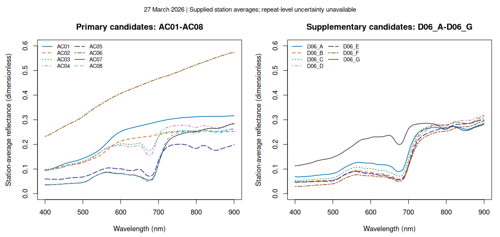

## Scientific summary

The supplied March 27 products differ consistently, but their accuracy against field reflectance cannot yet be assessed. Across the retained B02–B04 AOI records, ACOLITE reflectance is lower than operational Level-2A in every saved pair. Mean differences (ACOLITE minus L2A, dimensionless) are −0.11131, −0.10185 and −0.10373 in Arel, and −0.03386, −0.02884 and −0.02804 in Iwik, respectively. The discrepancy is larger in Arel in these supplied records; it does not establish processor superiority or a causal explanation.

The 15 station-average field spectra span 400–900 nm and pooled reflectance 0.02937–0.57363. Eight stations are primary candidates and seven supplementary. The product comparison retains 1,463 paired AOI cells (730 Arel; 733 Iwik), but none contains a field station: zero ASD-validation pairs are admitted. Nearby AOI pixels cannot replace station measurements. Pixel counts and wavelength channels are not independent field replicates; reported SD and quartiles describe spread, not estimation uncertainty.

Field footprints and positional support, the AC01/02 location discrepancy, overpass exposure/timing, QA and independent grouping remain unresolved; B08 remains held. Spectral resemblance does not establish ecological identity. Next steps are to resolve these physical and QA conditions and freeze support/grouping rules before station extraction. The present results support descriptive exploration only. This rewritten report awaits its own editorial/scientific reviews and PI consideration.

[Findings](#main-scientific-findings) · [Interpretation](#methodological-and-environmental-interpretation) · [Limitations and next steps](#limitations-and-next-steps) · [Methods](#materials-and-methods) · [Technical appendix](#technical-methods-quality-assurance-reproducibility-appendix)

## Research question and objectives

Can the supplied 27 March 2026 field spectra be compared fairly with the supplied operational Sentinel-2 Level-2A and ACOLITE surface reflectance? The objectives are to describe the existing field spectra and paired AOI product differences, establish what is comparable, and identify why accuracy against ASD remains not estimable. This editorial revision changes the order and framing of the existing evidence; it releases no scientific hold.

## Main scientific findings

### Observed magnitudes and their scope

In B02, B03 and B04 order, the mean paired differences are **−0.11131, −0.10185, −0.10373 in Arel**, and **−0.03386, −0.02884, −0.02804 in Iwik** (dimensionless reflectance). These are discrepancies between supplied products, without admitted ASD validation. Among the field spectra, AC06 has channel mean **0.42340** and AC05 **0.12420** over 400–900 nm; these describe station-average spectral curves, without repeat-level uncertainty or inferred ecological identity.

### Paired differences: ACOLITE minus operational L2A

{fig-alt="Six histograms of ACOLITE minus operational L2A; all observed differences negative; QA not validated."}

| AOI | band | n | mean | SD | Q1 | median | Q3 | minimum | maximum |
| --- | --- | --- | --- | --- | --- | --- | --- | --- | --- |
| Arel | B02 | 730 | -0.11131 | 0.01301 | -0.12130 | -0.10807 | -0.10095 | -0.14987 | -0.08820 |
| Arel | B03 | 730 | -0.10185 | 0.01340 | -0.11227 | -0.09781 | -0.09116 | -0.14198 | -0.07911 |
| Arel | B04 | 730 | -0.10373 | 0.01319 | -0.11287 | -0.09867 | -0.09396 | -0.14224 | -0.08034 |
| Iwik | B02 | 733 | -0.03386 | 0.00413 | -0.03698 | -0.03400 | -0.03068 | -0.04411 | -0.02317 |
| Iwik | B03 | 733 | -0.02884 | 0.00429 | -0.03228 | -0.02925 | -0.02524 | -0.03825 | -0.01887 |
| Iwik | B04 | 733 | -0.02804 | 0.00449 | -0.03163 | -0.02853 | -0.02405 | -0.03856 | -0.01872 |


Mean paired differences are Arel: B02 -0.11131, B03 -0.10185, B04 -0.10373; Iwik: B02 -0.03386, B03 -0.02884, B04 -0.02804. Every saved difference is negative for these AOIs and bands: the supplied ACOLITE values are lower than operational L2A values. The discrepancy is larger in Arel than Iwik in these records. This is not evidence of which method is closer to field reflectance. AOI selection, spatial dependence, unvalidated QA, exposed sediment/moisture, tidal state, adjacency and processing/support differences prevent a correction-accuracy or causal interpretation. No p-values, bootstrap intervals, equivalence claim or method ranking is calculated.

### Exploratory paired AOI product comparison

{fig-alt="Six AOI by band scatter panels, common reflectance axes and 1:1 line; QA not validated."}

The paired key is `(AOI, pixel_id)`, with identical centre coordinates and nominal 10 m boundaries across corrections. The 1,463 cells comprise 730 Arel and 733 Iwik records, repeated across the three bands; 4,389 band-pairs are not 4,389 independent samples. No resampling, spatial shift, range clipping or value-based cell selection was performed. Existing source spotchecks support encoding at their bounded sample only. The CSV values are already decoded: operational L2A source reflectance is `(DN - 1000)/10000` after masking native codes 0 and 65535; ACOLITE Float32 `rhos` is direct dimensionless reflectance. **No scale/offset was applied a second time.**

The descriptive retention rule is finite values in both corrections for a band, excluding recognized decoded L2A special codes -0.1 and 6.4535. Nonfinite/special exclusions are **zero** in all six AOI-band groups; all supplied primary-band pairs are retained. No QA mask is authenticated by this rule, and no QA-based exclusions are claimed. CSV export NoData/QA lineage and full effective support remain unresolved. `tables/descriptive_exclusions.csv` supplies every count.

Distribution statistics below use sample SD (`n - 1`) and linear interpolated quantiles (NumPy `method='linear'`, equivalent to R type 7: position `(n - 1)p` with zero-based indexing). Values are dimensionless; SD and IQR describe pixel spread, not uncertainty in correction accuracy. The underlying pixels are spatially dependent, selected AOIs rather than random ecological samples.

| AOI | band | method | n | mean | SD | Q1 | median | Q3 | minimum | maximum |
| --- | --- | --- | --- | --- | --- | --- | --- | --- | --- | --- |
| Arel | B02 | ACOLITE DSF | 730 | 0.27922 | 0.01739 | 0.26444 | 0.27754 | 0.29162 | 0.24160 | 0.32344 |
| Arel | B02 | operational L2A | 730 | 0.39053 | 0.02981 | 0.36555 | 0.38540 | 0.41363 | 0.32980 | 0.47310 |
| Arel | B03 | ACOLITE DSF | 730 | 0.35890 | 0.02007 | 0.34219 | 0.35657 | 0.37351 | 0.31569 | 0.41114 |
| Arel | B03 | operational L2A | 730 | 0.46075 | 0.03255 | 0.43410 | 0.45460 | 0.48510 | 0.39480 | 0.55180 |
| Arel | B04 | ACOLITE DSF | 730 | 0.45293 | 0.02271 | 0.43711 | 0.45016 | 0.47006 | 0.39596 | 0.50281 |
| Arel | B04 | operational L2A | 730 | 0.55665 | 0.03430 | 0.53130 | 0.54930 | 0.58337 | 0.47630 | 0.64160 |
| Iwik | B02 | ACOLITE DSF | 733 | 0.24395 | 0.00588 | 0.23968 | 0.24378 | 0.24786 | 0.22586 | 0.26372 |
| Iwik | B02 | operational L2A | 733 | 0.27781 | 0.00896 | 0.27150 | 0.27760 | 0.28390 | 0.25420 | 0.30540 |
| Iwik | B03 | ACOLITE DSF | 733 | 0.34282 | 0.00663 | 0.33819 | 0.34268 | 0.34744 | 0.32397 | 0.36321 |
| Iwik | B03 | operational L2A | 733 | 0.37166 | 0.00937 | 0.36470 | 0.37180 | 0.37840 | 0.34520 | 0.39890 |
| Iwik | B04 | ACOLITE DSF | 733 | 0.46542 | 0.00826 | 0.45946 | 0.46535 | 0.47118 | 0.44283 | 0.48737 |
| Iwik | B04 | operational L2A | 733 | 0.49346 | 0.01053 | 0.48680 | 0.49390 | 0.50100 | 0.46260 | 0.52150 |

### Station-average field spectra

{fig-alt="Fifteen field spectra in primary and supplementary panels; wavelength 400 to 900 nm and dimensionless reflectance."}

The following statistics describe each supplied spectrum over its 501 equally spaced 1 nm channels from 400 through 900 nm, inclusive. The mean is the unweighted arithmetic channel mean; sample SD (denominator 500), quartiles and range describe variation across wavelengths. **Wavelength channels are not field replicates, and this SD is not station measurement uncertainty.** No spectral smoothing or conversion was applied. All 7,515 selected values are finite; no wavelength channel was discarded. Literal labels remain in the machine-readable table and crosswalk; spectral appearance does not establish ecological identity.

| station_id | n | mean | SD | Q1 | median | Q3 | minimum | maximum |
| --- | --- | --- | --- | --- | --- | --- | --- | --- |
| AC01 | 501 | 0.24052 | 0.07698 | 0.15996 | 0.27459 | 0.30979 | 0.09452 | 0.31680 |
| AC02 | 501 | 0.20147 | 0.05656 | 0.14032 | 0.22816 | 0.25189 | 0.09589 | 0.25464 |
| AC03 | 501 | 0.19735 | 0.05584 | 0.14984 | 0.20107 | 0.25392 | 0.09335 | 0.26173 |
| AC04 | 501 | 0.20124 | 0.06455 | 0.14550 | 0.19319 | 0.27114 | 0.09860 | 0.28356 |
| AC05 | 501 | 0.12420 | 0.05424 | 0.07349 | 0.10083 | 0.18635 | 0.05800 | 0.20084 |
| AC06 | 501 | 0.42340 | 0.10038 | 0.34129 | 0.43795 | 0.50861 | 0.23236 | 0.57363 |
| AC07 | 501 | 0.13516 | 0.09335 | 0.05574 | 0.08153 | 0.24791 | 0.03555 | 0.28567 |
| AC08 | 501 | 0.13304 | 0.09071 | 0.05092 | 0.08319 | 0.24656 | 0.03710 | 0.26593 |
| D06_A | 501 | 0.16380 | 0.08180 | 0.09099 | 0.12392 | 0.26294 | 0.06802 | 0.28656 |
| D06_B | 501 | 0.14948 | 0.10159 | 0.06095 | 0.08800 | 0.27582 | 0.04619 | 0.31621 |
| D06_C | 501 | 0.15731 | 0.09738 | 0.07245 | 0.10196 | 0.27852 | 0.05354 | 0.30783 |
| D06_D | 501 | 0.14794 | 0.10381 | 0.05967 | 0.08223 | 0.27398 | 0.04880 | 0.31764 |
| D06_E | 501 | 0.14264 | 0.09787 | 0.05787 | 0.08378 | 0.25891 | 0.04645 | 0.29906 |
| D06_F | 501 | 0.13145 | 0.09811 | 0.05047 | 0.07263 | 0.24915 | 0.02937 | 0.29558 |
| D06_G | 501 | 0.21826 | 0.05642 | 0.16629 | 0.23041 | 0.26924 | 0.11282 | 0.28566 |


The table is rounded to five decimals for display; `tables/field_spectral_summary.csv` retains computation precision. Here n means wavelength channels per supplied station average, not independently sampled stations.

### Field locations and actual supplied AOI support

{fig-alt="All 15 unmatched stations and actual AOI cell footprints in EPSG:32628; AC01 and AC02 discrepancy retained."}

The Arel panel includes 13 nearest-AOI field locations and Iwik includes two; panel assignment is geographic plotting context, not a validated site or ecological crosswalk. D06_A/B nearly overlap at this scale; both records and labels are retained. The 15 nearest-centre distances span **15.851–989.715 m**, purely as distance diagnostics. A new read-only `gdaltransform` check from the supplied EPSG:4326 coordinates agrees with all saved EPSG:32628 points within 1e-6 m. This verifies the transform arithmetic, not GPS accuracy, field footprints or empirical image registration. There are zero station containing-cell joins; no nearest cell is substituted. The AOI cells nominally extend 5 m around their centres; effective sensor support remains unverified.

### Feasibility counts and denominators

| quantity | count | denominator |
| --- | --- | --- |
| date-eligible field spectra | 15 | 15 March27 station-average columns |
| primary candidate stations | 8 | 15 eligible stations |
| supplementary candidate stations | 7 | 15 eligible stations |
| paired AOI cells | 1463 | 1463 qualified (AOI,pixel_id) keys |
| Arel paired cells | 730 | 1463 paired AOI cells |
| Iwik paired cells | 733 | 1463 paired AOI cells |
| station/AOI containing-cell joins | 0 | 15 field stations |
| admitted ASD-validation band-pairs | 0 | 165 held candidate station-band rows; not observed n |
| held candidate ledger rows | 165 | 15 stations x 11 bands; design count only |
| possible primary band-pairs before holds | 24 | 8 stations x 3 bands; design maximum only |


ASD-validation bias, MAE, RMSE and R²: **not estimable: zero admitted field matchups**. Candidate design counts are not observed validation sample sizes. Final independent units remain unknown.

## Methodological and environmental interpretation

The negative product differences and their larger magnitudes in Arel describe these supplied AOIs. They do not identify the more accurate correction, because no physically admitted station matchups exist. Spatial dependence, selected AOIs and unvalidated QA prevent population-level inference. Exposed sediment/moisture, tidal state, adjacency and differences in processing or effective support remain potential confounders. No causal attribution, equivalence test or correction ranking is supported.

The spectral curves document variation in the supplied station averages. Channels are not repeated field measurements, and spectral similarity cannot resolve literal labels such as `mbp_mud` or identify species. The map establishes the support mismatch and preserves the AC01/02 discrepancy; nominal grid agreement does not validate image registration or field footprints.

## Limitations and next steps

**ASD-based bias, MAE, RMSE and R² remain not estimable: zero admitted field matchups.** B08 and material support/location/overpass/QA/grouping holds remain. Nearby pixels, supplementary candidates and diagnostic neighborhoods cannot silently replace the intended primary sample. SD/IQR describe spectral or pixel spread, without inferential uncertainty. The retained next-step record follows unchanged.

### Remaining evidence and questions

Essential field-owner evidence: actual sampled boundaries/area and positional accuracy sufficient to justify support; resolution of AC01/02 Iwik coordinates versus Arel text; exact field times/timezone and overpass exposure/wetness, or documented irrecoverability with a defensible bounded physical comparison. The new AOI extracts do not resolve these. Charles owns the existing reconciliation and question path; this amendment creates no duplicate PI question.

AC03 `mbp_mud` remains literal and unconfirmed relative to AC04 `mpb_mud`; unknown label alone need not invalidate an otherwise physical overall matchup but prevents an inferred ecological class. Detailed geometry, average membership/weights/variance, calibration certificate and preprocessing remain optional uncertainties to document if available, not automatic blockers by themselves. No resolved unit/datum/field-exposure question is repeated. `zn` expansion matters only if supplementary samples are separately proposed.

Technical dependencies: recover extract export/resampling/NoData/QA recipe and upstream contributor lineage or justified support envelope; verify native detector/defect masks and empirical registration; freeze support, grouping and coverage rules before extraction. Exact ACOLITE source/LUT/ancillary/SRF provenance remains incomplete, limiting reproducibility and attribution. Charles has selected the bounded supplied-product comparison; no new correction run is requested. Unknown essential QA/support remains a hold. **Readiness stays blocked for station extraction.**

## Materials and Methods

The existing analysis uses 15 supplied March 27 station-average ASD spectra (501 channels at 1 nm spacing over 400–900 nm), their evidenced station/date crosswalk, and paired supplied AOI CSV records for operational Sentinel-2B Level-2A and ACOLITE DSF. Reflectance is dimensionless. The CSVs are already decoded; no second scaling was applied. Pairing uses `(AOI, pixel_id)` at identical nominal 10 m centres. B02–B04 descriptive retention requires both values finite and excludes recognized decoded L2A special codes; zero such exclusions occurred. This rule does not authenticate QA.

Existing summaries use arithmetic means, sample SD and linearly interpolated quartiles (R type 7). No resampling, clipping, convolution, new extraction, correction run or inferential analysis was added. The original methods, source identities, units, CRS, masks, support specifications and complete held extraction–statistics contract are preserved below. Source scripts, tables, figures, outputs and provenance remain under `analysis/CTR-27_sen2cor-acolite-asd/` and are retained byte-for-byte.

## Technical Methods, Quality Assurance & Reproducibility appendix

### Revision and review boundary

This CTR-33 presentation is pinned to source code revision `9f0f06d2b5958b35de82adbca1577e4c384ae846`, associated with CTR-28 author document revision `7f45ae7b-2969-4c9e-8b83-51250fc21432`. It depends on draft PR #3 and targets that source branch in a distinct PR. The older independent-review revision `41b37e06-40fd-471b-b7de-ef3e2d339803` covers amendment `30bf024d129b70191b0ba90193eedc45dfc69b6a`; it does not cover the expanded source or this rewrite.

During this editorial task, Karl accepted the exact expanded source in [CTR-28 independent review](/CTR/issues/CTR-28#document-independent-review), revision `19a802d4-b1fa-4e67-b376-570dc689d939`, without unresolved critical or major findings in its bounded feasibility/descriptive scope. The authenticated [PI comment of 20 October 2026, 08:30:46.535 UTC](/CTR/issues/CTR-28#comment-22aa93c7-ae6a-4bd4-8bb5-970069b954c8) approves that submitted source deliverable; [the decision record](/CTR/issues/CTR-28#document-pi-decision), revision `69563c8a-c599-4898-a7ba-e644c54a4d48`, records its exact-source association and limits. Charles's source coordination stage remains pending. These decisions do not approve this CTR-33 revision, release field-validation holds, or authorize integration, merge or publication.

The source review's two non-blocking editorial points are addressed here: historical pending-status labels are explicitly superseded for the source by the decisions above, and concise alt text is added to the legacy SRF image in this presentation. Image bytes and visible caption are unchanged. All historical records below retain their original tense, paths, commands and status labels for provenance; they are not new execution claims or the current source decision state. No substantive scientific changes were requested by the new source review, and none has been introduced here.

`tables/content_map.csv` maps every original heading/body to this presentation. `tables/claim_evidence.csv` traces the new summary and framing to existing evidence. `provenance/preservation.json` records baseline comparisons and the checks actually performed for this editorial change. Historical numerical checks are retained separately and are not claimed as rerun here. If CTR-28 review changes substantive science or source files, reconcile the exact dependency and recheck affected CTR-33 claims before final review.

### Rebuild this presentation only

From the project root, run:

```bash
python3 analysis/CTR-33_scientific-first-report/scripts/build_report.py
./scripts/render-analysis.sh analysis/CTR-33_scientific-first-report
python3 analysis/CTR-33_scientific-first-report/scripts/verify.py
```

This generator reads saved report text and tables without accessing raw data. It writes only CTR-33 presentation files. The historical generator below continues to own the separate CTR-28 report and cannot overwrite this rewrite. `report.qmd` is editable; rebuilding restores the deterministic presentation, so intentional edits belong in this task's presentation generator as well.

### Retained historical technical and review record

Relative paths in the historical text refer to the original investigation unless a project-root command is shown. Figure paths are rebased for embedding and legacy SRF alt text is added. The following source content otherwise retains its original bodies, with heading levels changed.

### March 27 ASD–Sentinel-2 data readiness

**CTR-28 feasibility handoff for CTR-27. Readiness: blocked for scientific extraction and validation.** Date joins and satellite metadata are established, and an explicit proposed contract is delivered. Zero pairs are currently included for extraction or inferential use. This amended bounded feasibility audit is submitted for reassessment; the parent scientific comparison, independent review and PI decisions remain pending. The PI-authorized descriptive figures and statistics below are supplied-product exploration; accuracy against ASD remains not estimable.

### Question and scope

Can the supplied 27 March 2026 field spectra be compared fairly with the supplied operational Sentinel-2 Level-2A and ACOLITE surface reflectance? The audit separates evidence of date/identity from comparability of optical quantities and sampling support. It follows parent plan revision `e5d11291-44df-45ee-a80a-2e05b986c152` and reuses the CTR-25 dictionary revision `94e3777e-b618-4bf4-a88c-a7b502ca87d2`, commit `8d885c1c9ea1b10751dea939c2d1aee1432307bd`. The earlier dictionary was documentation, not scientific approval.

All edits are confined to `analysis/CTR-27_sen2cor-acolite-asd/`, initialized from `analysis/_template/`. `task.yml` records CTR-28 as implementation task. The clean starting checkout was fetched and passed `pi_guard.py preflight`; `verify-ready --task-id CTR-28 --agent roger-tomlinson --path analysis/CTR-27_sen2cor-acolite-asd/` returned ready, affected=false. The analysis exemption applies; no Ada synchronization mutation was required. Final manuscript and PI workspace were not edited.

### Amendment evidence

This amendment responds to Karl Popper's Major Revision, independent-review revision `71ca4c89-4664-4868-9eb2-07b4b9c9cd05`, covering audit revision `6fec859e-0973-430f-9486-f618deb59b6b` at commit `1cd34b042eca41f26da81e41fb838b7344357dca`. That earlier submission remains in Git history. The amendment incorporates Charles's reconciliation `f820bfe7-8b71-4344-8b19-15fca9a25164` and Thomas's concurrence `1f9de7bb-a5fb-4c73-ad90-7444529f2189`. `provenance/field_evidence.json` records the authenticated PI interaction `4765af59-1308-4dfe-8c85-19b3f5190b1f`, answered 20 October 2026 at 06:05:15.036 UTC. Field testimony resolves stated units, datum, station-average meaning, instrument/panel, qualitative geometry and field exposure; it is not calibration verification or scientific approval.

### Descriptive results and figures — PI-authorized expansion

This expansion implements the PI request of 20 October 2026, 06:27:52 UTC (comment `cd589b22-be5b-45ed-9df8-accc7ff5949e`) and independent review revision `41b37e06-40fd-471b-b7de-ef3e2d339803`, section D. These displays describe station spectra and the supplied AOI product values. **They do not validate either correction against ASD.** B08 remains held; no extra correction run, convolution, station reflectance extraction or QA release was performed.

#### Expansion verification and review response

Requests D1–D5 are addressed by `field-spectra`, `station-aoi-map`, `aoi-correction-comparison`, `aoi-paired-differences` and their six machine-readable summary/count/geometry tables. PNG figures are embedded in this standalone HTML; companion PDF files and CSV tables are delivered for inspection. `scripts/descriptive.py` computes statistics and promotes scratch figures through the existing safe figure writer under this investigation's `figures/generated/`; `scripts/descriptive_figures.R` draws the displays and independently recalculates all **33 summary rows** (15 spectra, 12 product distributions, six differences) within 1e-12. This cross-language author check does not replace Karl's independent review. No dependencies changed, no new raster values were read, all raw file size/mtime tuples were unchanged, and input hashes match their recorded values. `provenance/descriptive_run.json` records scope, parameters, hashes, transforms and software locks. Scientific field-validation holds and separate PI, manuscript, merge and publication gates remain in effect.

### Field evidence and exact proposed crosswalk

The measurement log explicitly assigns **day06 to 20260327**, including AC01–08 for Sentinel-2 atmospheric-correction validation and day06 cover/core sampling. GPS `Sheet1` rows **110–124**, date serial **46108**, independently agree on 27 March 2026 using the workbook's default 1900 date system. No measurement time is supplied; zero Excel fractional day is not interpreted as midnight observation.

There are **15 date-eligible spectral columns**: AC_01–AC_08 and D06_A–D06_G. The eight AC stations are primary design candidates; seven D06 spectra are supplementary candidates whose pixel-sized sampling is undocumented. `station_crosswalk.csv` encodes the explicit alias list, preserving all three raw identifiers. This is a proposed evidence-based join, not a generic string normalization rule. Every March 27 proposed ID has exactly one spectrum, cover row and GPS row; no duplicate or unmatched identifier occurs within these 15. `spectrum_disposition.csv` accounts for every supplied spectral column and excludes other days from this investigation.

| ASD column | Station | GPS row | Label (verbatim) | Latitude (raw) | Longitude (raw) | Role |
| --- | --- | --- | --- | --- | --- | --- |
| AC_01 | AC01 | 110 | dry_sand | 19.883937 | -16.294369 | primary_candidate |
| AC_02 | AC02 | 111 | dry_sand | 19.883816 | -16.294463 | primary_candidate |
| AC_03 | AC03 | 112 | mbp_mud | 19.895208 | -16.499679 | primary_candidate |
| AC_04 | AC04 | 113 | mpb_mud | 19.896477 | -16.500781 | primary_candidate |
| AC_05 | AC05 | 114 | algae_mud | 19.898096 | -16.504162 | primary_candidate |
| AC_06 | AC06 | 115 | white_sand | 19.898859 | -16.504517 | primary_candidate |
| AC_07 | AC07 | 116 | seagrass | 19.899799 | -16.508523 | primary_candidate |
| AC_08 | AC08 | 117 | seagrass | 19.897776 | -16.502755 | primary_candidate |
| D06_A | D06_A | 118 | zn | 19.898679 | -16.506917 | supplementary_candidate |
| D06_B | D06_B | 119 | zn | 19.898684 | -16.506903 | supplementary_candidate |
| D06_C | D06_C | 120 | zn | 19.898814 | -16.507075 | supplementary_candidate |
| D06_D | D06_D | 121 | zn | 19.899237 | -16.507142 | supplementary_candidate |
| D06_E | D06_E | 122 | zn | 19.899335 | -16.507878 | supplementary_candidate |
| D06_F | D06_F | 123 | zn | 19.899720 | -16.508063 | supplementary_candidate |
| D06_G | D06_G | 124 | sand | 19.899536 | -16.508149 | supplementary_candidate |


The PI confirms **WGS84 EPSG:4326** for the supplied coordinates. Positional accuracy and measurement footprints remain unknown. Both AC01 and AC02 have waypoint text `Iwik station` and coastal coordinates, while their workbook location says Arel; the record is preserved, not relocated to Arel. AC01/02 are approximately 21 km from the Arel AC group using the PI-confirmed WGS84 coordinates. The cover table has no GPS waypoint for them; the workbook supplies coordinates. All other March 27 cover/GPS waypoints agree. D06_A–F carry cover and core identifiers; D06_G has label `sand`, cover 0. Cover units, the code `zn` and Poskey interpretation are not invented.

`AC03=mbp_mud` and `AC04=mpb_mud` are retained separately. Whether the former is a spelling error requires field confirmation. `seagrass` and `zn` do not establish species. No classifier or spectral resemblance was used to identify ecological classes.

The supplied `POI_S2C_ACOLITE_targets` has **six** EPSG:32628 points, named T1–T6: Terrestrial soil, Water, Seagrass, Intertidal Sediment, Underwater Vegetation, Underwater Sand. It has no AC/day06 identifiers or acquisition dates. It cannot provide a field crosswalk or evidence of March 27 exposure. Under the PI-confirmed field WGS84 transform, nearest point distances are about 1.30 km for AC01/02 and 5.57–5.77 km for the Arel group. These are unmatched records, not aliases. The two time-series polygons have AOI Arel/Iwik and null id fields; they are broad AOIs, not the AC field footprints. Extent and square-mask polygons supply spatial context only. Relevant features and CRS are preserved in `outputs/vector_records.json`.

#### ASD quantity and sampling limitations

`202603_Reflectance_avg.txt` has **501 ordered wavelength rows**, numeric `wl` 400–900 at increment 1. All 15 candidate spectra are finite throughout; their pooled raw range is **0.0293690581–0.5736308287**. The PI confirms wavelengths in **nm** and reflectance **dimensionless 0–1**. No percent conversion or other scaling is applied. The original header alone does not supply these units.

The PI confirms that each supplied spectrum is a **station average**, measured with an **ASD Handheld FieldSpec2** and **99% Spectralon** panel, at nadir with the same stated angle/azimuth relative to the sun. All targets were intertidal and **exposed during field measurement**. This does not establish exposure/wetness at overpass or exact numerical solar/view angles, FOV or height.

The log records number-to-save 20 and spectrum counts white=50, dark=20, sample=50. For AC01–08 it states **5 × 20 spectra within an area the size of an S2 pixel**. The exact resolution/boundary, exported-average membership/weights, repeat variance, smoothing/noisy intervals and detailed panel calibration are not established. These optional details are documented uncertainties, not fabricated defaults or automatic stand-alone blockers for descriptive work. Unknown field support and material overpass-state changes remain essential holds. Raw repeat spectra and field images mentioned in the tables/log were not supplied in ASD/GPS. Day05/day07 water/glint/height details are not transferred to day06.

### Satellite identity, processing and spatial coverage

The expanded supplied product is **S2B_MSIL2A_20260327T113319_N0512_R080_T28QCH_20260327T152639.SAFE**. Product and datastrip XML identify Sentinel-2B, Level-2A, baseline **05.12**, relative orbit **80 descending**, absolute orbit **047296**, processing centre **2BPS**, generation **2026-03-27T15:26:39Z**. Product/datatake start is **11:33:19.024Z**. Tile XML, not the name alone, gives tile sensing **11:45:53.975343Z** and tile ID `S2B_OPER_MSI_L2A_TL_2BPS_20260327T152639_A047296_T28QCH_N05.12`.

This is an **operational Level-2A product using Sen2Cor-based processing**, not evidence of an independently rerun standalone Sen2Cor experiment. A standalone software version/configuration was not recovered; baseline and GIPP identifiers are available. No correction was rerun. The report should label this comparison operational L2A versus supplied ACOLITE DSF. Operational and user-generated L2A are distinct routes in the [official product documentation](https://sentiwiki.copernicus.eu/web/s2-products).

The 11 March 27 TIFFs in `S2/ACOLITE/20260327/` preserve embedded `NC_GLOBAL` metadata and band attributes even with PAM disabled. They explicitly identify **ACOLITE**, sensor `S2B_MSI`, L2W `rhos_*`, and **2026-03-27T11:45:53.975343+00:00**, exactly matching the L2A tile timestamp. Their source is recorded as `S2B_MSIL1C_20260327T113319_N0512_R080_T28QCH_20260327T150331.SAFE` under a historical Windows path; granule `L1C_T28QCH_A047296_20260327T113507`. Thus the same acquisition/platform/tile/orbit is supported by embedded headers. This does not prove byte-identical input ancestry: that March 27 Level-1C payload is not supplied for a hash check. The old Windows path is provenance, not an accessible input.

Recovered ACOLITE version is **Generic GitHub Clone c2026-04-07T11:45:24**, runid **20260407_115117**, generated **2026-04-07 13:26:22 Paris, Madrid (heure d’été)**. This string is not an exact Git commit. Settings embedded in every TIFF include `atmospheric_correction_method=dark_spectrum`, tiled AOT with intercept spectrum and min_drmsd selection, 600×600 tiles, linear tile interpolation and smoothing, selected `ac_model=ACOLITE-LUT-202110-MOD1`, target resolution 10 m, `warp_resampling_method=bilinear`, `l2w_parameters=rhos_*`, **l2w_mask=False**, no residual glint, interface-reflectance or adjacency correction. Model/header AOT values are processor provenance, not independent atmospheric measurements. An unused `dsf_fixed_lut=MOD2` setting must not replace the selected `ac_model=MOD1` in interpretation.

The TIFFs therefore recover much of the missing standalone 2026 settings/NetCDF provenance. Still missing are exact ACOLITE source SHA, LUT/ancillary content hashes, authenticated SRF version, complete execution log and recoverable March 27 source L1C. Current [ACOLITE source](https://github.com/acolite/acolite) and [GeoTIFF export code](https://raw.githubusercontent.com/acolite/acolite/main/acolite/output/nc_to_geotiff.py) explain the metadata/quantity conventions; current code does not authenticate the April clone. No settings from 2025 were substituted.

Both raster families declare **EPSG:32628**. L2A 10 m grid: origin **(300000,2300040)**, 10980×10980, bounds **x=300000–409800, y=2190240–2300040 m**. ACOLITE 10 m grid: origin **(334050,2209980)**, 3763×1974, bounds **x=334050–371680, y=2190240–2209980 m**. The AC crop is inside the SAFE grid, offset exactly **3405 columns and 9006 rows** at 10 m. This verifies grid alignment, not empirical geolocation or image registration accuracy.

L2A has B01–B09, B8A, B11 and B12 (12 unique bands); B10 is absent. Four 10 m bands are supplied, the 20 m set includes B01, and 60 m also includes B09. Native B01 support remains 60 m even where resampled to 20 m. ACOLITE has 11 `rhos` bands, including B01/B8A/B11/B12 but neither B09 nor B10. No March27 `l2_flags` file is supplied. Exact paths and per-band metadata are in `band_contract.csv` and captured headers.

| Band | ACOLITE variable | Native support (m) | Response coverage (%) | Proposed role |
| --- | --- | --- | --- | --- |
| B11 | rhos_1610 | 20 | 0.0000 | held: no ASD spectral coverage |
| B12 | rhos_2186 | 20 | 0.0000 | held: no ASD spectral coverage |
| B01 | rhos_442 | 60 | 100.0000 | held: coarser native field support unestablished |
| B02 | rhos_492 | 10 | 100.0000 | primary_candidate_10m |
| B03 | rhos_559 | 10 | 100.0000 | primary_candidate_10m |
| B04 | rhos_665 | 10 | 100.0000 | primary_candidate_10m |
| B05 | rhos_704 | 20 | 100.0000 | held: coarser native field support unestablished |
| B06 | rhos_739 | 20 | 100.0000 | held: coarser native field support unestablished |
| B07 | rhos_780 | 20 | 100.0000 | held: coarser native field support unestablished |
| B08 | rhos_833 | 10 | 99.4858 | held: incomplete B08 spectral coverage |
| B8A | rhos_864 | 20 | 100.0000 | held: coarser native field support unestablished |

#### Decode and quality contract

For L2A, product XML declares **BOA_QUANTIFICATION_VALUE=10000**, all 13 band-index offsets **−1000**, NODATA=0 and SATURATED=65535. Mask special codes first, then decode **(DN−1000)/10000**; JP2 band defaults alone are insufficient. This follows [official encoding guidance](https://sentiwiki.copernicus.eu/web/s2-products). ACOLITE TIFF bands are Float32 with unit **1**, `surface_bidirectional_reflectance`, NaN NoData and no additional scale/offset declared: read finite float values directly. Never divide them by 10000 or multiply by π. Do not compare Rrs (sr−1) directly to dimensionless reflectance; a π conversion alone cannot establish matching geometry or optical definitions.

Proposed common quality screening rejects SCL codes **0,1,2,3,7,8,9,10,11** and uses 4/5/6 only with independent field exposure evidence. Apply the same common mask to both methods; do not use an aquatic bright-land mask to discard the dry sand targets. Decode native defect/detector masks at extraction stage and require all pixels in an agreed primary support to pass. Do not silently average over a reduced footprint. ACOLITE l2w_mask=False means finite pixels alone are not a cloud or glint guarantee. Keep valid negative reflectance with flags rather than clipping to improve fit. SCL is processor classification, not ecological truth or independent accuracy.

### Spectral convolution specification and version choice

Primary reference remains the **supplied v4.0 S2B average response** sheet, hashed with the input inventory. The workbook Overview documents ground-measured instrument responses and nm units for wavelength columns. The PI independently confirms ASD wavelengths in nm. No Gaussian or nominal central-wavelength substitute is used.

For the later released extraction, compute each band as **∫Rfield(λ)Sband(λ)dλ / ∫Sband(λ)dλ**, trapezoid integration on the union of ASD and SRF knots with linear interpolation only between finite consecutive ASD samples separated by at most 1 nm. Preserve response normalization; a peak-normalized response need not have unit area. Reject a nonfinite, missing or known noisy interval intersecting positive SRF support. Do not extrapolate, fill with zero or silently normalize a truncated band. Proposed minimum response coverage is **99.9%**, fixed before any algorithm ranking; threshold is a conservative design choice, not an instrument accuracy specification. Supplied S2B responses have no negative response entries.

With PI-confirmed ASD nm units, B01–B07 and B8A have full supplied response coverage. **B08 spans 774–907 nm and only 99.4857969% is covered**: hold it from primary inference. B09, B10, B11 and B12 have no ASD support. B09/10 also lack a supplied correction pair. No missing wavelengths are fabricated. Even B01/red-edge/B8A cannot be promoted without field support at their native 60/20 m resolutions.

{fig-alt="S2B spectral-response coverage for field wavelengths 400–900 nm; B08 is below the 99.9% threshold. Coverage does not establish spatial or QA eligibility."}

The [20 August 2026 official SRF update](https://sentinels.copernicus.eu/-/sentinel-2-spectral-response-functions-update) announces v5 refinements and removal of negligible edge noise, intended for PB05.13. Our scene is PB05.12. V4 is retained to preserve the supplied design reference; this is not proof that every processor used exactly this workbook. The official v5 workbook was downloaded separately through the [SentiWiki library](https://sentiwiki.copernicus.eu/web/s2-documents), SHA-256 **42be3ebd8bfcbde11c37caeb2e2fdda65fefa8d2b6f8329559b7806d02cdc9e2**. It was not substituted into the supplied raw data.

Numerical response-only sensitivity finds v4→v5 equivalent-wavelength changes B02 **−0.015509 nm**, B03 **+0.003757 nm**, B04 **−0.011218 nm**; normalized response L1 distances respectively **0.0006682, 0.0017852, 0.0029923**. These are response-shape diagnostics, not reflectance errors. V5 B08 coverage is **99.5009575%**, still below 99.9%; the eligibility decision is unchanged. `srf_v5_sensitivity.csv` contains all 13 bands. After physical/QA holds are resolved, report a separate v5 convolved-reference sensitivity without changing the primary reference. Do not infer ACOLITE's exact SRF version from its rounded wavelength labels.

### Spatial and temporal extraction specification

With field CRS confirmed, establish the sampled area before extraction, transform coordinates explicitly (traditional GIS order lon,lat), retain raw coordinates, and use the **containing native 10 m pixel for B02/B03/B04** only if it represents the sampled area. Match the identical pixel boundary across corrections. If a genuine field polygon spans pixels, use a prespecified area-weighted aggregate of the same physical boundary for both methods and document the mismatch to the sensor point-spread function. No value-based selection of pixel, window, shift or tide tolerance is permitted. A fixed 3×3 neighborhood is a sensitivity/support diagnostic, not nine extra field replicates.

For coarser bands, require a demonstrably homogeneous 20/60 m field region; the existing 10 m ACOLITE interpolation cannot recreate native resolution. Any later common coarse grid must have explicit anchor and bounds, area-weighted reflectance aggregation and nearest-neighbor categorical masks. Keep original mask support and report coverage. B01 stored at 20 m does not become a 20 m observation.

Small diagnostic reads were repeated using the **PI-confirmed EPSG:4326 coordinates**. The historical column names containing `if_wgs84`/`hypothetical` are retained for traceability; their current evidence status is explicit in each record. These locators do not validate physical field support. At all 15 locations both B04 products have 9/9 finite/non-special pixels in 3×3 windows. SCL neighborhoods were also read. Total requested windows: **15×3×9=405 values** (logical reads can overlap; underlying driver blocks may be larger). No full raster statistics or scene processing occurred; diagnostic reflectance pairs were not calculated or passed to statistics.

AC01/02 have SCL centre 5; AC03–06 and AC08 centre 6; AC07 centre 4. SCL6 at stations labelled mud/sand/seagrass is a material exposure/mixture question, not proof that either the field label or classification is wrong. D06_A and D06_B are **1.567 m apart and share one 10 m pixel** using the confirmed CRS. AC01/02 are only **16.620 m apart** and share a 20 m SCL cell. Record D06_A/B as a shared candidate native-cell relation outside the primary population. Record AC01/02 sharing as a **QA-only relation**, not a radiometric merge. Final components and independent units remain unestablished; overlapping diagnostic neighborhoods are not primary contributors. Heterogeneous neighborhoods, GPS error, adjacency, sediment moisture, epiphytes, glint, atmospheric correction, tide and water column can all confound differences.

Grid alignment is established. Image-to-ground and inter-product registration are not: assess stable independent features/UAV or ground control before extraction, record residual offsets/uncertainty, and use a prespecified ±1 pixel sensitivity without fitting to ASD agreement. No co-registration shifts were applied.

The tile time is known to subsecond precision; exact field UTC interval/timezone and overpass tidal/exposure state are not established. Same date alone is not a validated matchup interval. Seek field start/end times and overpass state, or document irrecoverability and a bounded physical justification; use a named tide source/model/datum if reconstructed. Field exposure is already confirmed and is not asked again. No retrospective “close enough” time/tide tolerance is asserted. Unresolved material exposure/wetness changes keep affected records held. Missing exact timing may permit only a documented physically justified descriptive comparison; date agreement alone does not supply it.

### New AOI extracts: intake and source reconciliation

The actual case-sensitive location is **`data/raw/Atm_Compare_AOI`**; uppercase `Data` does not exist in this project. `tables/aoi_input_inventory.csv` inventories the supplied folder and whole-file SHA-256 hashes the two used March27 CSVs. Other dated files were inventoried by path/stat only and excluded from table/value inspection. Originals were read only. Historical Windows source strings are retained as provenance addresses, not accessible Linux inputs.

| Correction | AOI (raw) | Pixel rows | Bands |
| --- | --- | --- | --- |
| ACOLITE | Arel | 730 | B01, B02, B03, B04, B05, B06, B07, B08, B8A, B11, B12 |
| ACOLITE | Iwik | 733 | B01, B02, B03, B04, B05, B06, B07, B08, B8A, B11, B12 |
| Sen2Cor | Arel | 730 | B01, B02, B03, B04, B05, B06, B07, B08, B8A, B09, B11, B12 |
| Sen2Cor | Iwik | 733 | B01, B02, B03, B04, B05, B06, B07, B08, B8A, B09, B11, B12 |


These files contain **pixel records across broad AOIs, not station means**. They have no station identifier, ecological label, explicit CRS/unit/NoData specification, QA columns, aggregation weights or producer script. `pixel_id` restarts in each AOI: only the qualified `(AOI, pixel_id)` key is unique. All 1,463 keys pair one-to-one across corrections, with exactly equal centre coordinates and 10 m nominal boundaries. All row/column centres match the respective EPSG:32628 source grids under a zero-based convention, and offsets are exactly 3,405 columns / 9,006 rows. The CSV scene identities match the supplied L2A product and ACOLITE stem; the tile metadata supplies the exact time. These checks establish nominal source/grid relationships, not field support, effective kernel equivalence or valid QA.

The centre-in-polygon cell sets were reconstructed from supplied `TimeSeries_Polygons_Matchup.shp`, with results in `outputs/aoi_intake.json`. This tests a candidate rasterization rule; it does not authenticate the producer's implementation. No station containing cell matches the CSV support at the confirmed GPS coordinates: **0 of 15**. Nearest CSV cell centres are 15.85–989.71 m from field positions. Even the nearest AC06 point is outside its containing-cell coverage; nearest neighbors are never aliases. `tables/aoi_station_join.csv` preserves every unmatched station. AOI names do not resolve the AC01/02 location conflict.

Six cells chosen without reference to ASD (first, midpoint and last record within each AOI) were checked in every available band, totaling **138 scalar raster reads**, followed by six B01 representation checks (**144** total in this amendment). `tables/aoi_source_spotchecks.csv` records source address, row/column, raw and decoded values and sample hashes. For primary B02–B04, all **36/36** values match their own source decode within 1e-7; this is an encoding diagnostic, not an atmospheric-correction performance metric. The six L2A B01 comparisons differ from the native-60 m stored representation. Follow-up comparisons use the supplied stored-20 m B01 representation; this does not change B01 native sensor support (60 m). The bounded checks are summarized below. Matching a coarser stored cell cannot recover unknown native weights; mismatching it does not by itself prove an error because the CSV resampling recipe is absent.

Source-check mismatches against the containing stored cell: {"Sen2Cor:B01": 6}. B01 stored-20m follow-up: 6/6 match. Polygon centre-set checks: [{"AOI": "Arel", "CSV_cells": 730, "centre_in_polygon_cells": 730, "exact_centre_set_match": true, "extra_cells": 0, "missing_cells": 0}, {"AOI": "Iwik", "CSV_cells": 733, "centre_in_polygon_cells": 733, "exact_centre_set_match": true, "extra_cells": 0, "missing_cells": 0}]. Full per-record diagnostics are retained; no correction-to-ASD error is calculated.

The CSVs contain no QA or contributor counts. Their paired nominal cell set cannot establish common effective sensor support, which matters particularly for coarse bands resampled to 10 m. Headers document ACOLITE bilinear warping; native L1C contributors/weights and the CSV export recipe remain unavailable. No field polygon, station-to-AOI crosswalk or correction-specific full-support mask is inferred. The supplied AOI values therefore stay outside the station match-up ledger, whose reflectance values remain empty. No new correction run or full station extraction was performed.

### Normalized extraction–statistics contract

All **165 candidates** (15 stations × 11 paired bands) remain in `tables/proposed_matchups.csv`, mapped one-to-one to `outputs/normalized_design.json`. The stable key is `(target_id, occasion_id, band_id, extraction_version)`, with `matchup_id`, separate reference/scene-pair/source IDs, literal IDs, evidenced 1:1:1 joins, raw class, primary/supplementary role and reason-bearing states. The single exported average per station is established; its repeat composition and exact physical occasion remain unknown. Empty CSV fields / JSON null mean unknown or not evaluated, never zero or passed QA. All inclusion and paired-valid booleans remain false. The maximum **24 primary candidate band-pairs** is not a realized sample size.

The normalized file supplies targets, references, occasions, source identities with explicit full-file versus header/sample identity strength, scene pairs, matchups, **330 candidate radiometric-support records**, separate QA cells/links and target-level complete-spectrum states. Candidate cell locators are explicitly not approved primary contributors: field footprints remain unknown, numerical extraction weights and contributor counts are null. Source/output grid IDs, boundaries, native/output resolutions and upstream-lineage gaps are recorded. Diagnostic 3×3 windows never acquire primary weights. Actual upstream contributors or a defensible conservative support envelope must be supplied before support-based grouping can be implemented.

`outputs/dependence_graph.json` records typed relations and a version/hash. Its primary domain is AC01–08 and B02–B04 with actual primary contributors. Shared QA support is auxiliary; D06_A/B sharing a nominal native 10 m cell is outside the primary domain. Actual field overlap, native radiometric sharing across either correction, repeated units and documented site dependence require union, transitive closure and any evidenced site/block merges **before errors are inspected**. Components cannot later be split by method, band, type or exclusions. Site/footprint/ACOLITE upstream support remain unresolved, so final components, resampling-unit IDs, independent G and statistical weights are null.

`outputs/data_contract.json` carries Thomas's concurrence. For each band P_b requires reference and both methods to pass the same physical/full-support QA rule; P* is their target intersection across the fixed three bands. Main facets use identical P* targets and ASD references. Equal-unit weights are `1/(G × T_g × 3)` for P*, and `1/(G_b × T_gb)` per band, identical across corrections; extraction weights are separate. RMSE is the square root of weighted squared error. Complete-case coverage must disclose targets/units, literal/verified classes, sites, timing/exposure/support and ordered losses. Charles/Roger must freeze the metadata-based representativeness justification before errors; an absent intended class/site or systematic exposure/QA loss precludes an unqualified primary-population claim. Unknown classes stay unknown.

If P* is empty, pooled metrics are NA with a reason; valid P_b tables can be reported after physical release. If P* is unrepresentative, any summary describes only that subset and a primary-population ranking is withheld. Charles must record a dated amendment before a band-stratified replacement figure/estimand. No silent band drop, imputation or supplementary substitution is allowed. At most eight primary targets cannot meet the design's 20-unit interval rule: no bootstrap, inferential intervals or p-values are planned. G=0 yields no estimate; G=1–4 permits descriptive results; G=5–19 additionally requires unit contrasts and leave-one-unit-out sensitivity. Unknown grouping is reported as unknown. No ASD-based bias, MAE, RMSE, correlation, R², inference or ranking is computed here. The separate AOI summaries describe paired product differences only.

### Response to independent review

1. **Physical evidence superseded:** `scripts/audit.py`, crosswalk/ledger, report, figure and `provenance/field_evidence.json` now use the authenticated units, CRS, mean status, instrument/panel, qualitative geometry and exposed field state. Material footprint/location/overpass holds remain; optional uncertainties are distinguished.
2. **New extracts:** `scripts/amend.py`, input inventory, station join, source spotchecks and `outputs/aoi_intake.json` document exact path/hashes, identities, nominal support and missing QA/resampling. No valid station join was found; no AOI value was substituted for ASD-station reflectance.
3. **Contract:** normalized stable identities, separate candidate radiometric and QA support, typed unresolved graph, validity/null/reason states, full ledger retention and Thomas's grouping/complete-case/weight/fallback rules are delivered. This remains a held design, not an extraction release.

Minor finding: band-specific hold reasons now distinguish absent ASD spectral coverage, incomplete B08 coverage and unestablished 20/60 m field support. No band was promoted.

### Reproducibility, validation and review

Run from the project root:

```bash
.venv/bin/python analysis/CTR-27_sen2cor-acolite-asd/scripts/audit.py
.venv/bin/python analysis/CTR-27_sen2cor-acolite-asd/scripts/amend.py
./scripts/project-env.sh Rscript analysis/CTR-27_sen2cor-acolite-asd/scripts/coverage_figure.R
.venv/bin/python analysis/CTR-27_sen2cor-acolite-asd/scripts/descriptive.py
.venv/bin/python analysis/CTR-27_sen2cor-acolite-asd/scripts/build_report.py
./scripts/render-analysis.sh analysis/CTR-27_sen2cor-acolite-asd
.venv/bin/python analysis/CTR-27_sen2cor-acolite-asd/scripts/validate.py
```

Audit assertions check unique source IDs/date joins, monotone wavelength grid, metadata/units/NoData/grid consistency across 11 ACOLITE bands, L2A offsets, manifest count and all inclusion holds. Source stat tuples for all supplied files were unchanged during the audit. Small inputs/metadata/reference files are SHA-256 hashed. Rasters are documented by path/stat/header and sampled-window hashes; no whole-scene hashes were computed. This distinction limits byte-identity claims. PAM is disabled and originals remain untouched. The v5 download is separately named and exact-hash checked on rerun.

Environment: Python 3.12.3, NumPy 2.5.4, GDAL 3.8.4, released 2024/02/08. Source base 1cd34b042eca41f26da81e41fb838b7344357dca; branch `ctr-28-matchup-feasibility`. UV lock SHA-256 `99b03c9488832607c0a51cfc114a49c45626b6376e8ada71a07509e78995c0b1`; renv lock SHA-256 `6174d90c07f13d864c15d472b098d819a1a36cff25e5b1e6c2031937aa66b707`.

Technical verification of this amendment passed: the locked project environment check, all 34 preservation tests, standalone HTML rendering, input-hash verification, ledger/key/foreign-key checks and held-validity invariants. These are author checks; independent numerical/scientific review remains pending.

No dependencies, environment lockfiles or system software were changed. The standalone Quarto configuration does not inherit or render the final manuscript. `provenance/deliverable_manifest.json` identifies exact delivered file hashes; `provenance/run.json` records commands, environment and input provenance. A report cannot include its own final hash. `provenance/amendment_run.json` records the intake checks, stat preservation and explicit bounded read count. Original submission provenance remains recoverable at its exact Git commit; current outputs supersede it only within this investigation.

**Independent review pending. PI scientific approval pending. Manuscript integration, merge and publication not authorized.** Charles receives this handoff for scientific coordination and review routing. The readiness block concerns the parent extraction/comparison; the feasibility audit delivers an evidence-based missing-input decision.

### CTR-33 review status

This editorial submission awaits Rachel Carson's exact-revision editorial read, Karl Popper's independent evidence-fidelity and reproducibility review, and Charles Darwin's check of both verdicts and PI-review package. The author cannot approve this analysis. PI scientific approval, manuscript integration, merge and public publication remain separate and unauthorized here.
